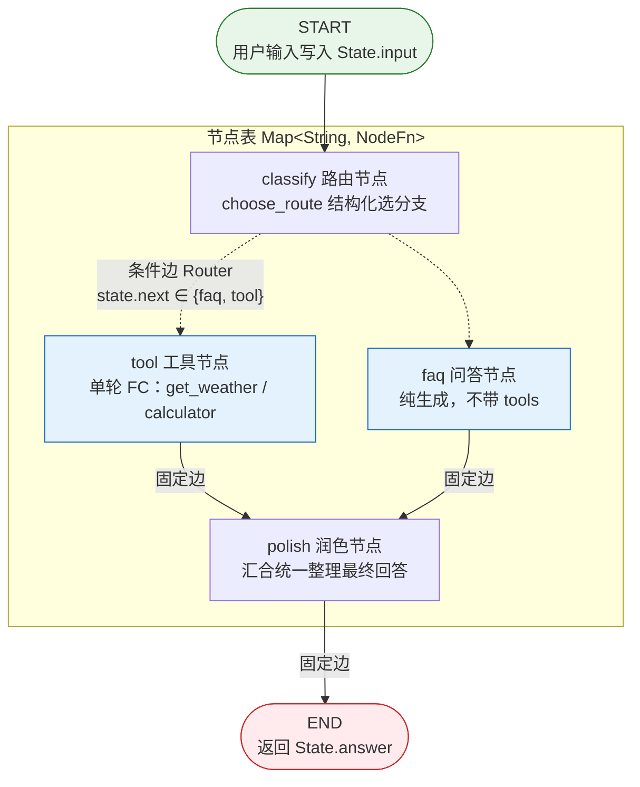
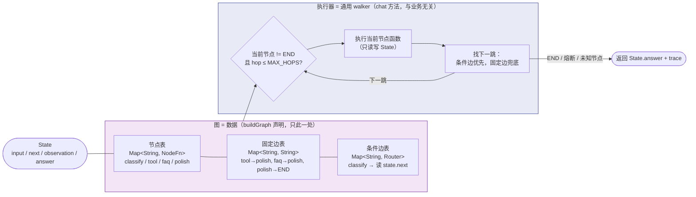
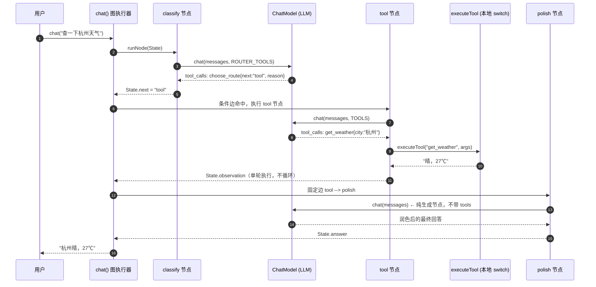
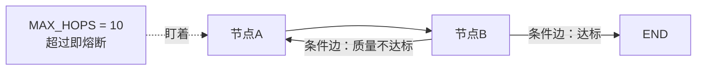
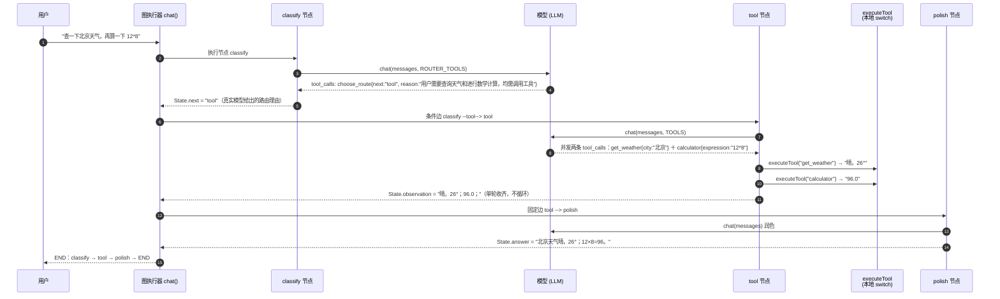

# Step16 · WorkflowAgent 设计图解

> 核心思想一句话：**图是数据（节点表 + 边表），执行器是通用 walker，流程说了算。**

| 本实现 | LangGraph 对应概念 |
|---|---|
| `nodes.put(name, fn)` | `graph.add_node(name, fn)` |
| `edges.put(from, to)` | `graph.add_edge(from, to)` |
| `conditionalEdges.put(from, router)` | `graph.add_conditional_edges(from, router)` |
| `chat()` 里的 while-walker | `graph.invoke(state)` 的图执行循环 |
| `MAX_HOPS` | `recursion_limit` |
| `State: Map<String,Object>` | `TypedDict / Pydantic State` |

## 一、总览：图的拓扑与一次典型流转

实线 = 固定边（拓扑直达），虚线 = 条件边（路由器读 State 决定）。



走哪条路由模型在 classify 节点里经 `choose_route` 结构化决定：
问天气/算数 → `tool` 分支；普通闲聊 → `faq` 分支。但**能不能转圈、转到哪汇合，全是拓扑说了算**——节点函数自己不知道图长什么样。

## 二、设计全景：三个数据结构 + 一个通用执行器

LangGraph 的三个一等公民在这里全部落成 Map：



想加节点、改分支、把图改成带环的 → 只改 `buildGraph()`，`chat()` 一行不动。
这就是"图是一等公民"：**拓扑是配置，不是代码。**

## 三、一次 tool 分支请求的完整时序

模型对接走标准 Function Calling（`choose_route` 路由 + `tools` 字段工具清单 + tool_calls 结构化回填）：



注意 6–10：tool 节点只执行**一轮** Function Calling——节点内不允许自由转圈，
这是工作流与 ReAct 的本质区别：**ReAct 转不转模型说了算，工作流转不转拓扑说了算。**

## 四、成环能力与保险丝

LangGraph 允许图带环（比如"质量不达标 → 打回重做"），本实现同样支持——
条件边路由器返回已走过的节点名即可成环。正因为允许成环，执行器带了 `MAX_HOPS = 10` 保险丝：



这与 Step15 的 `MAX_STEPS` 是同一件事：**只要存在循环的可能，无论循环属于模型（ReAct）还是属于拓扑（工作流），运行时都必须有保险丝。**

## 五、与市面框架的对照

| 本实现 | LangGraph 对应概念 |
|---|---|
| `nodes.put(name, fn)` | `graph.add_node(name, fn)` |
| `edges.put(from, to)` | `graph.add_edge(from, to)` |
| `conditionalEdges.put(from, router)` | `graph.add_conditional_edges(from, router)` |
| `chat()` 里的 while-walker | `graph.invoke(state)` 的图执行循环 |
| `MAX_HOPS` | `recursion_limit` |
| `State: Map<String,Object>` | `TypedDict / Pydantic State` |

差异只有一条：LangGraph 的 State 有类型系统与通道合并（reducer）语义，教学版用 `Map` 直传——骨架思想完全同构。

## 六、官方资源

| 用途 | 地址 |
|---|---|
| 产品主页 | https://www.langchain.com/langgraph |
| 官方文档总览（Python） | https://docs.langchain.com/oss/python/langgraph/overview |
| **官方 Quickstart（最短对照案例，计算器 Agent）** | https://docs.langchain.com/oss/python/langgraph/quickstart |
| Graph API 概念 | https://docs.langchain.com/oss/python/langgraph/graph-api |
| GitHub 仓库 | https://github.com/langchain-ai/langgraph |

> 注意：langgraph.com.cn / langgraph.org.cn / github.langchain.ac.cn 等均为第三方中文镜像站，非官网。

**官方 Quickstart 与本实现的对应关系**（quickstart 的 `agent_builder` ≙ 本类的 `buildGraph()`）：

```python
agent_builder.add_node("llm_call", llm_call)      # ≙ nodes.put("classify", this::classifyNode) ...
agent_builder.add_node("tool_node", tool_node)
agent_builder.add_edge(START, "llm_call")          # ≙ start = "classify"
agent_builder.add_edge("tool_node", "llm_call")    # ≙ edges.put("tool", "polish") ...
agent_builder.add_conditional_edges(               # ≙ conditionalEdges.put("classify", state -> ...)
    "llm_call", should_continue, ["tool_node", END])
agent = agent_builder.compile()                    # ≙ chat() 里的通用 walker
agent.invoke({"messages": messages})               # ≙ chat(input)
```

条件边路由函数 `should_continue`（读 State 判断有无 tool_calls → 返回下一跳）与本类的 `Router` 接口逐字同构。课后拿这段 Python 对照本类 Java，10 分钟即可亲眼确认"同一个设计"。


## 七、执行轨迹

输入：`查一下北京天气，再算一下 12*8`，输出：`北京天气晴，26°；12×8=96。`



trace 事件与图上步骤的对应关系（8 条 trace 全部入图，步骤号 = `autonumber` 序号）：

| trace 事件 | 类型 | 图上步骤 |
|---|---|---|
| 路由决策 → tool（含模型给出的理由） | node | 4–5 |
| classify --tool--> tool 节点 | edge | 6 |
| get_weather {"city":"北京"} | tool | 8（并发发起）· 9（执行） |
| calculator {"expression":"12*8"} | tool | 8（并发发起）· 10（执行） |
| 晴，26°；96.0； | node | 11 |
| tool --> polish | edge | 12 |
| 最终回答已生成 | node | 13–14 |
| 执行路径: classify → tool → polish → END | edge | 15 |

**两个值得盯住的细节**：

1. **第 8 步是并发 tool_calls**——模型在一轮回复里同时发起了 get_weather 和 calculator 两个调用，执行器在第 9–10 步依次执行、分别按 tool_call_id 回填，这正是标准 Function Calling 协议的多工具能力；
2. **第 11 步单轮收齐不循环**——工具结果写入 State 后直接走固定边去 polish，节点内不回模型再问一轮：转不转圈，拓扑说了算（与 ReAct 的本质区别在真实轨迹里的样子）。
